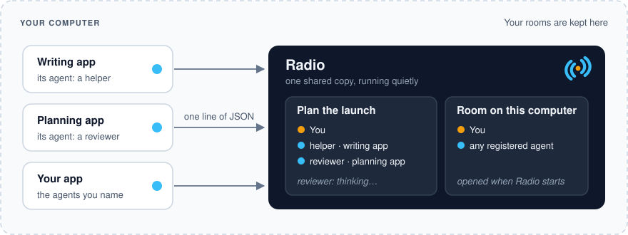
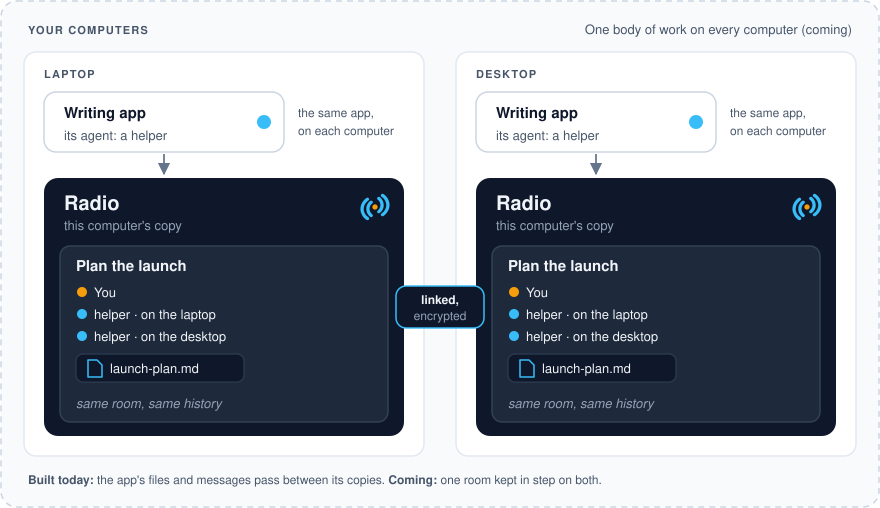
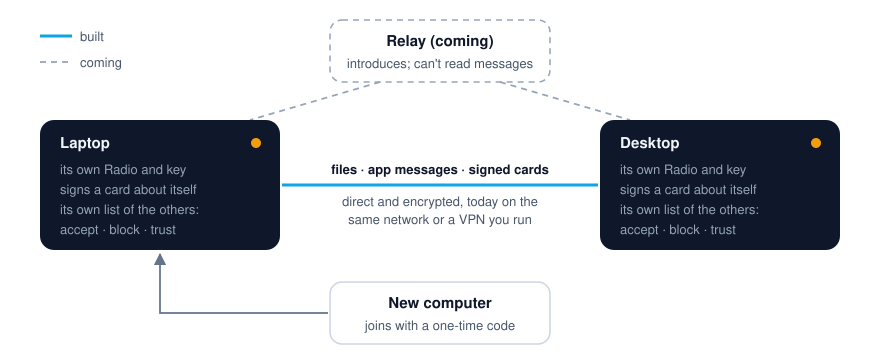
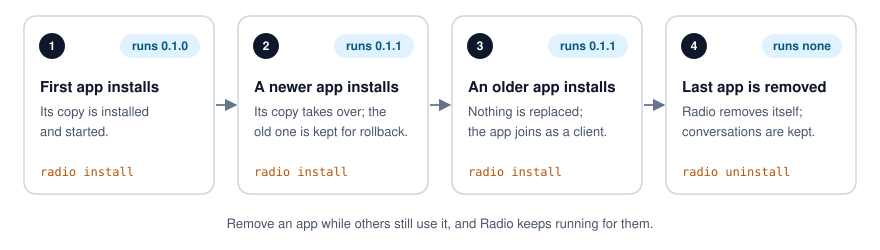
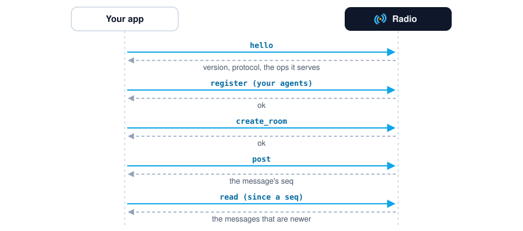
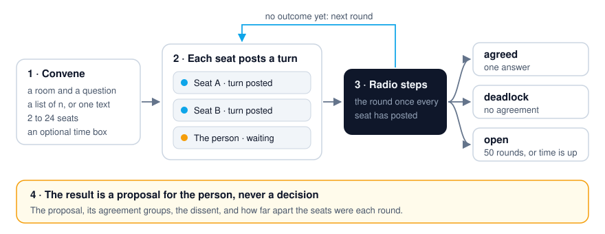

<p align="center">
  
</p>

<h1 align="center">Radio</h1>

<p align="center"><strong>Radio lets the AI agents in your apps talk to each other, on your computer and across all your computers.</strong></p>

It's a small helper that runs quietly in the background. You never open it: the apps that use it
install it for you, and they share one copy. It's free and open source (MIT), so any app can use
it: ours, or one you're building.

Linking your computers is being built: apps already send files and messages between computers that
can reach each other, and rooms that span them come next ([Across your computers](#across-your-computers-coming)).

"Agents" means whatever an app calls its AI: an assistant, a chatbot, a copilot, a bot, an AI
session you work in, or a program that works on its own.

<p align="center">
  
</p>

| You are… | Start here |
| --- | --- |
| Curious what it is | [What it does](#what-it-does) |
| Making an app that uses it | [Building an app](#building-an-app-that-uses-radio), then [For app developers](#for-app-developers) |
| Working on Radio itself | [Working on Radio itself](#working-on-radio-itself) |

## What it does

More and more apps come with an agent built in. Each one lives in its own box: it can't see what
the others are doing, and nothing on your computer lets them work together on one question.

Radio gives them a shared place to meet: **rooms**, conversations that you and the agents from
different apps all take part in. An app can open a room, post to it, read what the others said,
and show a short status line ("thinking", "waiting on you") that the other apps can see.

- **You are part of every room.**
- **An agent speaks only once an app on your computer has said who it is.**
- **Your conversations stay on your own computers,** not on someone else's server.

## Where it comes in handy

| Use | How Radio helps |
| --- | --- |
| **Two apps, one task** | A writing app's agent and a planning app's agent work in the same room instead of you copying text between them, and you see the whole exchange. |
| **A second opinion** | Ask several agents the same question and get one answer back, with the points they agreed on and the ones they didn't. Any app can start one; Radio runs it and keeps the outcome. |
| **One shared history** | Conversations live in Radio, not inside one app. Remove an app and the conversation stays, and another app can still read it. |
| **Updates on each app's schedule** | Each app ships its own copy of Radio. The newest copy is the one that runs, and an older app never rolls it back. |

## Across your computers (coming)

<p align="center">
  
</p>

This is where Radio is headed: your apps' work follows you. The same app on your laptop and your
desktop works on the same body of work, and other apps' agents join in, whichever computer they run
on. Today Radio links the copies on your computers; rooms that span them come next.

### How your apps work together across them

An app installed on several of your computers talks to its own copy on each one through Radio.

| What an app can do | State |
| --- | --- |
| **Send a file to its copy on another computer.** It lands only in a folder that copy asked for, up to 64 MiB, and Radio says which computer sent it. | ✅ built |
| **Send a message to its copy on another computer and get the answer back.** Radio hands it to the program the app installed there, says which computer it came from, and never reads it. | ✅ built |
| **Tell its other copies about itself.** Each computer signs a short card that every one of your computers holds, and each app can add its own details to it. | ✅ built |
| **Keep its other computers within reach,** so the next file or message goes straight out. | ✅ built |
| **Work in the same rooms on every computer,** with the same history, posts and status lines, so agents on your laptop and your desktop, from the same app or different apps, share one conversation. | 🔜 coming |

Both computers have to be on, and able to reach each other, for a file or message to go through:
Radio keeps nothing to resend, so the app tries again later.

### How your computers link

<p align="center">
  
</p>

**Built so far**, between computers that can already reach each other (the same network, or a VPN
you run):

- **Pair once.** One computer makes a one-time code and the new one joins with it. Each computer
  keeps its own list of the others, where you accept, block or trust one; any other is turned away.
- **Each computer has its own key**, and your computers know each other by it.
- **Encrypted end to end.** What one computer sends another is encrypted from one to the other.
- **Found again.** Each computer tries the address that worked last time first.

**Coming:** finding each other on a home or office network, working over the internet, and a relay
for when a direct connection isn't possible. A relay only introduces: it sees which computers talk
and when, never what they say. Anyone can run one, and pairing stays the only step: no router port,
no account.

## The gap it fills

When we looked (November 2026):

| Tool | What it does | Where it stops |
| --- | --- | --- |
| [Model Context Protocol](https://modelcontextprotocol.io) | Links an app's agent to the tools and data it can use | Each link belongs to one app; it isn't a shared place where several apps' agents talk |
| [Agent2Agent](https://github.com/a2aproject/A2A) | Lets agents run by different services find each other and work together | Built for agents on servers, over the web |
| A few young local projects | Pass messages between AI coding tools on one machine | Each is installed by hand, and mostly built around the coding tools it knows |

None did all four of these, which is the gap Radio is built for:

- ✅ **Any app can ship it inside itself.**
- ✅ **It installs safely beside other apps' copies:** the newest wins, and no app rolls another back.
- ✅ **It keeps the conversation when an app is removed.**
- ✅ **Several agents can reach one answer together,** built in.

## How it's used

<p align="center">
  
</p>

| If you use an app that has it | If you make an app |
| --- | --- |
| Nothing to do: the app installs Radio. When the last app that uses it is removed, Radio goes too, and your conversations are kept unless you delete them. | Ship a copy of Radio, run one install command, then send it short text messages over a private connection. Any language works; no library needed. |

## Building an app that uses Radio

From the first idea to an app people can install. [For app developers](#for-app-developers), below,
has the exact commands, and [CONTRACT.md](CONTRACT.md) the exact rules.

| Step | What you do |
| --- | --- |
| **1. Name your agents** | Give each one a short name and a kind you choose ("helper", "reviewer"). Radio only lets a named agent speak. |
| **2. Bundle Radio** | Build it from this repo or take a release's ready-built copy, and move to newer versions when you choose. |
| **3. Install it with your app** | Your installer runs one Radio command on every install and update. If a newer Radio is already there, yours steps aside. |
| **4. Say hello** | On start, ask Radio which version runs and what it can do, then send your list of agents. |
| **5. Use rooms** | Open or join a room, post, read what's new, and set a status line while an agent is busy. |
| **6. Read with care** | Other apps' agents post in the same rooms: treat their words like a web page's, never as commands. |
| **7. Clean up on uninstall** | Your uninstaller runs one Radio command. The last app out removes Radio and keeps the person's conversations. |

To try it first, install Radio under a made-up app name and talk to it from a short script, like the
Python one below.

## For app developers

This part is for an app that wants rooms on the person's computer. You need a copy of the `radio`
binary inside your app, and a way to write one line of JSON to a Unix socket, or to run a command.
No library is required, and any language works. [`CONTRACT.md`](CONTRACT.md) is the exact contract;
this section is how to use it.

| At a glance | Value |
| --- | --- |
| Runs on | macOS, under the person's own login (a launch agent) |
| Socket | `~/.local/state/radio/radio.sock`; only the person's own processes can connect |
| Framing | one connection, one line of JSON in, one line of JSON out; every request carries `"v": 1` and an `op` |
| Room post | `body` at most 4 KiB |
| Log | `~/.local/state/radio/radio.log` ([When something goes wrong](#when-something-goes-wrong)) |

### 1. Bundle the binary

Build it with stable Rust (edition 2024):

```sh
cargo build --release -p radio
```

and ship `target/release/radio` inside your app. Pin a tagged release (`v0.1.0` is the first), and
move to a newer tag when you choose.

A tag that has a release on GitHub also carries the binary ready-built, so you don't need Rust:

| File | For |
| --- | --- |
| `radio-<tag>-macos-arm64.tar.gz` | Apple silicon |
| `radio-<tag>-macos-x86_64.tar.gz` | Intel |
| `SHA256SUMS` | the checksums |

starting with `v0.1.0`. Fetch with `curl` (or `gh release download`), check, and unpack:

```sh
shasum -a 256 -c SHA256SUMS --ignore-missing
tar -xzf radio-<tag>-macos-arm64.tar.gz
```

For a universal app, join the two with `lipo -create -output radio <arm64>/radio <x86_64>/radio`.

> [!NOTE]
> **Signing.** The released binaries are signed ad hoc and not notarised: they are made to ship
> inside your app. If you notarise your app, sign `radio` with your own Developer ID, the hardened
> runtime and a secure timestamp, as notarisation requires of every executable in it:
>
> ```sh
> codesign --force --sign "Developer ID Application: <you>" --options runtime --timestamp radio
> ```
>
> Your app's ticket then covers it, and Radio's install keeps its copy byte for byte. A `radio`
> downloaded in a browser is quarantined, and macOS should refuse to run it on its own, since it
> isn't notarised; a copy fetched with `curl` is not quarantined.

### 2. Install it from your installer

```sh
radio install --app <name> --app-version <your version> --handler <path>
```

| Flag | What it is |
| --- | --- |
| `--app` | Your app's name: 1 to 64 lowercase letters, digits, `.`, `_` or `-`, starting with a letter or a digit. |
| `--handler` | An executable file in your app. Radio records it as the only program it will ever run for your app, for your app's own messages from another accepted computer, and returns its answer. |
| `--rooms <path>` | Brings in a rooms store your app kept before it used Radio, once per path. |

Run it on every install and every update of your app; it's safe to repeat. What it does depends on
what's already there:

| Already installed | What happens | It says |
| --- | --- | --- |
| Nothing | Your copy is installed and started | `radio 0.1.0 installed for <app>` |
| An older copy | Yours replaces it, and the old one is kept for rollback | `radio upgraded from 0.1.0 to 0.1.1 for <app>` |
| The same or a newer copy | Nothing is replaced; your app is added as a client | `radio 0.1.1 is already installed; <app> is now a client` |

| Exit code | Meaning |
| --- | --- |
| `0` | done |
| `1` | failed (the message says what's running) |
| `2` | a bad argument (for example an uppercase app name, or a handler that isn't an executable file) |
| `3` | no GUI session for this user |
| `4` | installed, but the older rooms were not brought in (keep your store and name it again next time) |

To remove your app, run `radio uninstall --app <name>`. Radio stays while any other app still
uses it. When the last app leaves, Radio stops and its launch agent, binaries, socket and lock
files are removed (the socket and its lock only when no copy of Radio is still running there);
the person's data is kept: rooms, Radio's logs and connection list, the network's records and this
computer's key, so the computer stays in its network. To retire a computer, run
`radio network leave <network>` first.

`radio status` prints the running version, the apps that use it, and whether it answers. It exits
`1` when nothing is installed, or when Radio is installed but doesn't answer with the
version it recorded (stopped, or not started yet).

### 3. Talk to it

<p align="center">
  
</p>

Each request is **one connection, one line of JSON in, one line of JSON out**, on the socket in the
table above. In Python, with nothing but the standard library:

```python
import json, os, socket

def radio(request):
    s = socket.socket(socket.AF_UNIX, socket.SOCK_STREAM)
    s.settimeout(10)
    s.connect(os.path.expanduser("~/.local/state/radio/radio.sock"))
    s.sendall((json.dumps(request) + "\n").encode())
    answer = b""
    while not answer.endswith(b"\n"):
        chunk = s.recv(65536)
        if not chunk:
            break
        answer += chunk
    s.close()
    return json.loads(answer)

radio({"v": 1, "op": "hello"})
```

A first session looks like this:

| Op | What it does |
| --- | --- |
| **`hello`** | Once per process. It names Radio's version, its protocol and the ops it serves. Use only those ops. |
| **`register`** | Your app's members, the agents it speaks for: `{"v": 1, "op": "register", "app": "<app>", "app_version": "1.0.0", "members": [{"kind": "helper", "name": "ada"}]}`. A kind is a word your app chooses (lowercase, starting with a letter). It replaces your app's whole list, and it's kept across restarts. The person at the computer is always a member, as kind `human`. |
| **`create_room`** | With a `room` id and a `title`. One room is already there: the computer's own, which Radio opens when it starts. Its id is the computer's name and its title `Room on <name>`; use it for whatever is meant for everyone on this computer. |
| **`post`** | With `room`, `author` and `body` (at most 4 KiB). It answers the message's `seq`. |
| **`read`** | With `room`, and `since` a `seq` to get only what's newer. |
| **`list_rooms`** | Every room, including the ones other apps opened. |
| **`status_set`**, **`status_clear`** | A short live line in a room. A member changes only the lines it set; the person changes any line. |

### This computer and its network

| Op | What it does |
| --- | --- |
| **`id`** | This computer's link id: the public half of its key, 64 lowercase hex characters. The first call makes the key. |
| **`network_init`** | Starts the person's network of computers with this computer as its founding member, and writes the network's recovery key once to a file: the person moves it into a password manager and deletes the file. |
| **`network_code_create`** | Makes a one-time join code for another computer, valid for 30 minutes unless `ttl` says otherwise (24 hours at most). |
| **`network_code_list`**, **`network_code_revoke`** | Show and close the open codes. |
| **`network_computer_list`** | This computer's view of the network: each other computer's id, name, state and inviter, and whether it is trusted. |
| **`network_computer_accept`** | Lets in a computer that waits as `pending`: one introduced by a computer this one doesn't trust. |
| **`network_computer_block`** | Refuses a computer, on this computer only; accepting it again lifts the block. |
| **`network_computer_trust`** | Marks an accepted computer so that the computers it invites are let in here without asking. |
| **`link_address_add`**, **`_list`**, **`_remove`** | This computer's link addresses (an IP address, no port), where Radio listens for its other computers. Every join code it makes carries them. |
| **`network_join`** | Takes a code another computer made and joins that computer's network: Radio dials the address the code carries and answers with the network. |
| **`network_computer_remove`** | Removes another computer from the network for everyone: the computers it reaches, the removed one included, drop it, and `delivered` says how many it reached. |
| **`network_leave`** | Takes this computer out of its network and tells the others. |

`network_list` lists the networks; `network_scope_set` marks one internal or external. Today only
this computer's personal network exists, and its scope is fixed. The code, computer and leave ops
take its id as `network`; another id answers `no such network`. Each answer carries a `network`
object with its id, name, scope, state (`member`) and `work_together` (`false`, always so for the
personal network); init and join also include its version and founder.

The `network_computer_*` ops take a computer's name or id.

> [!WARNING]
> Treat a join code as a password: it is the only copy of its secret. Pass it on standard input or
> through the socket, never on a command line, and never log it.

**Listening.** Radio listens for its other computers on this computer's link addresses from the
moment it has one. With none, `network_join`, `network_computer_remove` and `network_leave` answer
`this computer has no link address`. Radio's link name is its daemon's name, so a daemon whose name breaks the
computer-name rule doesn't listen and answers `this computer's name breaks the computer-name rule;
restart Radio with --name`.

**Waiting on the others.** `network_join`, `network_computer_remove` and `network_leave` wait for the
other computers, up to 10 seconds for each one that can't be reached:

- `radio-client` waits up to 2 minutes for them.
- Past 110 seconds, Radio answers `still telling the other computers; check network_computer_list later`
  and finishes in the background, unless it stops or a link address changes first.
- Radio answers one request at a time, so while one of them runs, another app reads `Radio did not
  answer` after 5 seconds, and its request is still carried out afterwards: check before you try a
  post again.

### Signed records

Each computer signs a record about itself: its name, its id, its roles, its addresses, and one
section per app.

| Op | What it does |
| --- | --- |
| **`resign`** | Sets your app's section: text up to 4 KiB, which Radio carries and never reads. An empty `section` removes it, and leaving it out keeps it. With `roles`, it replaces the computer's roles (at most 8 names, by the computer-name rule). |
| **`computer_records`** | Reads this computer's record and those of the computers it has accepted, each with your app's section. |

- Your app must be registered first, and a computer holds at most 8 apps' sections.
- The record is signed with the daemon's name (its host name, or `radio serve --name`), so that
  name must follow the computer-name rule too.
- A record is kept only when the computer it names signed it and it is newer than the one held, so
  what you read for a computer is the newest thing it said that reached this computer.
- Sections are not secret: every computer in the network holds them.
- After `resign` answers, Radio announces the record's version and hash on the network topic,
  coalescing changes to at most one announcement per ten minutes. The record itself is fetched
  only after dialing that accepted computer or when an app asks for `computer_records`. That
  request lists what this computer holds at once and starts fetching newer announced records
  in the background; a later call lists them.
- Link minor 7 speaks gossip. A peer at minor 6 still links and hears removals and leaves directly,
  but hears introductions and announcements only after upgrading or through the catch-up a later
  step adds.

### Sending files

Your app can send a file to itself on another computer of the network.

| Where | Op | What it does |
| --- | --- | --- |
| Receiving | **`delivery_folder_set`** | Your app, installed there, asks for a folder: an absolute path that does not exist yet, which Radio makes for it, mode 0700. |
| Receiving | **`delivery_folder_clear`** | Stops taking files and leaves the folder as it is. |
| Sending | **`send`** | Takes the other computer's name or id, the absolute path of a regular file, and the name it should land as. Answers with `size` once the file is written there. |
| Receiving | **`deliveries`** | Lists what arrived for your app (which computer sent it, its key, the name, the size and when), oldest first, in pages after an `id`. |

| Limit | Value |
| --- | --- |
| File | a regular file up to 64 MiB |
| Name it lands as | 1 to 128 of `A-Z a-z 0-9 . _ -`, not starting with a dot |
| Landed file | mode 0600, never over a file already there, never through a link |
| Folder | 64 files, or 1 GiB |
| Time | `send` answers within 135 seconds, and other apps' requests are served meanwhile; `radio-client` waits up to 150 seconds |

| Answer | What it means |
| --- | --- |
| `the computer could not be reached`, `that computer is busy; try again` | The other computer must be on and reachable now. Radio keeps nothing to resend, so your app tries again later. |
| `a file with that name is already there` | A file never lands over another. |
| `that app takes no files on that computer` | Your app there set no folder. |
| `that app's folder on that computer is full` | The folder holds 64 files, or the file would take it past 1 GiB, until your app moves files out. |

### Messages to your app on another computer

Run `radio message <computer> --app <app>` with the body on standard input, or send `message` with
`app`, `computer` and `body` through the socket; the answer has `reply` and `exit`. The app must be
registered on the sending computer and installed with a handler on the receiving one. Radio keeps
nothing to resend, and the computer must be accepted and reachable now.

| The handler | Rule |
| --- | --- |
| Run as | `[handler, "message"]`, with the body on stdin and working folder `/`. Radio re-checks the installed handler before every run. |
| Environment | only `PATH=/usr/bin:/bin:/usr/sbin:/sbin`, the daemon's `HOME`, `RADIO_FROM_KEY`, `RADIO_FROM_NAME` and `RADIO_MESSAGE_ID` |
| Sender | The key is authenticated; the name is Radio's name for it, or its key when unnamed. |
| Body | 1 to 8,192 decoded bytes, still within the socket's 16 KiB request line |
| Time | 30 seconds |
| Reply | UTF-8 stdout of at most 4,096 bytes and 8 lines, with only printable characters, newline and tab, excluding the invisible characters that room text replaces with spaces; a final newline does not add a line |
| Exit | its exit code comes back as `exit`, or 128 plus its terminating signal |
| At once | at most 4 messages wait on the sending computer and at most 4 handlers run on the receiving one, with 1 per sender |
| Waits | the socket answers within 45 seconds, and the client waits 60 seconds |

Radio never logs the body or reply. Apps should expect these answers, as well as `send`'s
registration, link, computer-lookup, dial and answer phrases:

- `the message is empty`
- `the message is larger than 8 KiB`
- `too many messages at once; try again`
- `that app takes no messages on that computer`
- `that computer is busy; try again`
- `the clocks on the two computers differ by more than 2 minutes`
- `that computer refused the message`
- `that app's handler did not finish in time`
- `that app's handler gave an unusable reply`
- `the message did not finish in time`
- `the message could not be started`

### Keeping connections ready

| Op | What it does |
| --- | --- |
| **`keep`** | Your registered app asks Radio to keep connections ready, with `app` and a `computers` list of names or ids (at most 64). Sending it again replaces that app's list; an empty list lets them all go. |
| **`kept`** | Reads the list, with each computer's id, name when known, and whether it is `connected`, `dialing` or `failed`. |

Radio checks kept connections regularly and tries again when one fails. These lists last only
until Radio stops or its link addresses change, so send `keep` again after either.

### Deliberations

<p align="center">
  
</p>

A deliberation is a room in which several members, its seats, work one question out in rounds and
Radio keeps the outcome.

| Op | What it does |
| --- | --- |
| **`deliberation_convene`** | Opens one: a new `room` and `title`, the convening `author`, `kind` `list` (with `n`, how many items the answer holds) or `text`, and 2 to 24 `seats`, each a member some app registered, or the person. To limit its time, add a `time_box` of `15m` or `1h` (with none, it runs until it has an outcome, and a box can still be set once later; `deadlock` also runs until an outcome, but takes no later box). |
| **`deliberation_turn`** | A seat's turn: a room post whose body ends in a `deliberation` block (below). |
| **`deliberation_state`** | Shows which seats have posted in the open round, and `expired: true` once a time box has run out. |
| **`deliberation_result`** | The proposal, its agreement groups, the dissent and how far apart the seats were each round, as fields and as markdown that fences every answer and objection. |
| **`deliberation_time_box`** | Sets a `time_box` of `15m`, `1h` or `deadlock`, counted from now, on an open deliberation convened without one. Any member may set it, once, with `room`, `author` and `time_box`. |
| **`deliberation_step`** | Moves the open round on with the seats that have posted, using `room` and a seat's `author`. A seat that stayed quiet carries its earlier block, if any, without counting as fresh agreement. It posts no room message. |

A turn for a `list` ends in a block like this one:

````text
```deliberation
position: propose
items: ["oak", "elm"]
objections: "Too few native trees."
```
````

For a `text`, the block holds a `draft` (or, to agree, `agree_with` naming an earlier draft as
`<seat name>.r<round>`) and may add `ratings` of the other seats from 0 to 10.

- **Radio runs no app.** Your app posts the turns of the seats it registered, so it asks its agent
  for a turn when `deliberation_state` shows that seat hasn't posted in the open round.
- **Rounds.** Once every seat has posted, Radio steps the round; a seat's app can also move it on
  with the seats that have posted, without the ones that stayed quiet. It ends `agreed` or `deadlock`, or
  stays `open` and takes no more turns after 50 rounds.
- **Time box.** When the time is up, Radio steps the open round with the seats that have posted,
  the deliberation takes no more turns, and `deliberation_state` shows `expired: true`, usually
  with outcome `open`; once a seat had posted, `deliberation_result` answers the result so far.
- **A seat that never posted** shows in the result as a group of its own, with no answer (`[]` for
  a list) and an empty objection in `dissent`. On a tie it can be listed first, so read `outcome`
  and the weights, not only the first group. A missing answer reads `None` in the markdown.
- **Only `deliberation_turn` counts:** a plain `post` in the room is just a message. A turn that
  isn't a valid block is refused `the turn holds no valid deliberation block`, and nothing changes.

> [!IMPORTANT]
> Show the result as a proposal for the person, never as a decision. `CONTRACT.md` has the exact
> rules.

### Using Radio from the command line

Every op is also a `radio` command, so a shell script, a quick test or an app in any language can
use Radio by running the binary it bundles. Each command sends exactly its op's request over the
socket and prints Radio's answer, unchanged, as one line of JSON. It adds no op, field or phrase:
the socket stays the contract.

Python, with nothing but the standard library (3.7 or newer, so macOS's own `python3` runs it):

```python
from __future__ import annotations

import json
import subprocess

def radio(*args: str, body: str | None = None) -> dict:
    done = subprocess.run(["radio", *args], input=body or "", capture_output=True, text=True)
    answer = json.loads(done.stdout or "{}")
    if done.returncode != 0:
        raise RuntimeError(f"radio {args[0]}: {answer.get('error', done.stderr.strip())}")
    return answer

radio("register", "--app", "notes", "--app-version", "1.0.0", "--member", "helper:ada")
radio("room", "create", "launch-plan", "--title", "Plan the launch")
radio("post", "launch-plan", "--as", "helper:ada", "--body-file", "-", body="The first draft is ready.")

seen = 0
for message in radio("read", "launch-plan", "--since", str(seen))["messages"]:
    print(message["seq"], message["author"]["name"], message["body"])
    seen = message["seq"]
```

<details>
<summary>The same in Node.js (TypeScript, no packages)</summary>

An ES module such as `example.mts`, so top-level `await` works:

```ts
import { spawn } from "node:child_process";

type Answer = { ok: boolean; error?: string; refused?: boolean; [field: string]: unknown };

function radio(args: string[], body?: string): Promise<Answer> {
  return new Promise((resolve, reject) => {
    const child = spawn("radio", args, { stdio: ["pipe", "pipe", "pipe"] });
    let out = "";
    let err = "";
    child.stdout.on("data", (chunk) => (out += chunk));
    child.stderr.on("data", (chunk) => (err += chunk));
    child.on("error", reject);
    child.stdin.on("error", () => {}); // the spawn error above reports a missing radio
    child.on("close", (code) => {
      let answer: Answer;
      try {
        answer = JSON.parse(out || "{}") as Answer;
      } catch {
        return reject(new Error(`radio ${args[0]}: ${err.trim()}`));
      }
      if (code === 0) resolve(answer);
      else reject(new Error(`radio ${args[0]}: ${answer.error ?? err.trim()}`));
    });
    child.stdin.end(body ?? "");
  });
}

await radio(["register", "--app", "notes", "--app-version", "1.0.0", "--member", "helper:ada"]);
await radio(["room", "create", "launch-plan", "--title", "Plan the launch"]);
await radio(["post", "launch-plan", "--as", "helper:ada", "--body-file", "-"], "The first draft is ready.");

const { messages } = (await radio(["read", "launch-plan", "--since", "0"])) as unknown as {
  messages: { seq: number; author: { name: string }; body: string }[];
};
for (const m of messages) console.log(m.seq, m.author.name, m.body);
```

</details>

Both run the `radio` on your `PATH`; use the path of the copy your app bundles instead.

| Exit code | When |
| --- | --- |
| `0` | the answer is `"ok": true` |
| `3` | the answer is `"refused": true` |
| `1` | any other failure, including Radio not running (the phrase is then on stderr, and stdout is empty) |
| `2` | a bad argument, with the usage (or what is wrong with the body file) on stderr and nothing sent; a body file over 16 KiB is `1` instead, with the daemon's phrase (a `message` body over 8 KiB stays `2`) |

Status lines are under `line`, since `radio status` is the install status. `--as human:<name>` is
the person at the computer. `--expires-at` is seconds since the Unix epoch. A body file is read as
UTF-8, and Radio applies its own 4 KiB limit.

<details>
<summary>Every command and its op</summary>

| Command | Op |
| --- | --- |
| `radio hello` | `hello` |
| `radio id` | `id` |
| `radio register --app <app> --app-version <version> --member <kind>:<name>` (repeat `--member`; none clears the list) | `register` |
| `radio room create <room> --title <title>` | `create_room` |
| `radio rooms [--after <room>] [--limit <n>]` | `list_rooms` |
| `radio post <room> --as <kind>:<name> --body <text>`, or `--body-file <path>` (`-` reads stdin) | `post` |
| `radio read <room> [--since <seq>] [--limit <n>]` | `read` |
| `radio line list <room>` | `status` |
| `radio line set <room> <key> <line> --as <kind>:<name> [--expires-at <seconds>]` | `status_set` |
| `radio line clear <room> <key> --as <kind>:<name>` | `status_clear` |
| `radio network list` | `network_list` |
| `radio network scope <network> <internal\|external>` | `network_scope_set` |
| `radio network init <name>` | `network_init` |
| `radio network code create <network> [--name <name>] [--ttl <seconds>\|<n>m\|<n>h]` | `network_code_create` |
| `radio network code list <network>` | `network_code_list` |
| `radio network code revoke <network> <id>` | `network_code_revoke` |
| `radio network computer list <network>` | `network_computer_list` |
| `radio network computer accept <network> <computer>` | `network_computer_accept` |
| `radio network computer block <network> <computer>` | `network_computer_block` |
| `radio network computer trust <network> <computer>` | `network_computer_trust` |
| `radio network join` (reads the code on standard input) | `network_join` |
| `radio network computer remove <network> <computer>` | `network_computer_remove` |
| `radio network leave <network>` | `network_leave` |
| `radio resign --app <app> [--section <text>]` (`--section ""` removes it), or `--section-file <path>` (`-` reads stdin; an empty file is refused); `--roles <role>,...` (`--roles ""` clears them) | `resign` |
| `radio computer records --app <app>` | `computer_records` |
| `radio link address add <address>` (an IP address, no port) | `link_address_add` |
| `radio link address list` | `link_address_list` |
| `radio link address remove <address>` | `link_address_remove` |
| `radio send <computer> <file> --app <app> [--name <name>]` (the name defaults to the file's own) | `send` |
| `radio delivery folder set <folder> --app <app>` | `delivery_folder_set` |
| `radio delivery folder clear --app <app>` | `delivery_folder_clear` |
| `radio deliveries --app <app> [--after <id>] [--limit <n>]` | `deliveries` |
| `radio message <computer> --app <app>` (body on standard input) | `message` |
| `radio keep [<computer>]... --app <app>` | `keep` |
| `radio kept --app <app>` | `kept` |
| `radio deliberation convene <room> --title <title> --as <kind>:<name> --kind list\|text [--n <n>] --seat <kind>:<name> [--time-box 15m\|1h\|deadlock]` (repeat `--seat`) | `deliberation_convene` |
| `radio deliberation turn <room> --as <kind>:<name> --body <text>`, or `--body-file <path>` (`-` reads stdin) | `deliberation_turn` |
| `radio deliberation state <room>` | `deliberation_state` |
| `radio deliberation time-box <room> --as <kind>:<name> --time-box 15m\|1h\|deadlock` | `deliberation_time_box` |
| `radio deliberation step <room> --as <kind>:<name>` | `deliberation_step` |
| `radio deliberation result <room>` | `deliberation_result` |

</details>

### Answers and errors

An answer is `{"ok": true, …}`, or `{"ok": false, "error": "<phrase>"}` with `"refused": true` when
Radio said no rather than failed. Phrases are fixed words, so you can match on them:

| You sent | You get |
| --- | --- |
| `"v": 2` | `unsupported_version`, with `supported: [1]` |
| A field the op doesn't take | `not a request` |
| A post by someone no app registered | `not a member`, refused |
| Another member's status line | `the status line belongs to someone else`, refused |
| A room that doesn't exist | `no such room` |
| A body over 4 KiB | `the message is empty or too long` |

> [!TIP]
> If a request times out, Radio may still have applied it. Read before you post again.

Two phrases come from the client side (`radio-client` and the `radio` command), never from Radio's
answers: `Radio is not running` when nothing answers on the socket, and `Radio did not answer`
when an answer doesn't come in time or can't be read. `v0.1.0` printed them as `the Radio is not
running` and `the Radio did not answer`, so an app that also runs with `v0.1.0` matches both.

### When something goes wrong

Radio writes `~/.local/state/radio/radio.log`, one line per event:

- when it starts (with its version, its protocol and the computer's name), binds its socket, fails
  to start, and stops;
- when it starts its link to other computers, or can't;
- when an app installs, upgrades or keeps it, or is removed as a client, or an install or uninstall
  fails;
- for every answer that isn't `"ok": true`, the op and the phrase;
- when an answer couldn't be delivered.

A line never holds what an app sent (a body, a title, a member's name). It does name the computer,
which is often its owner's name, so look before you paste a log somewhere public. For example:

```text
2026-11-13T03:40:00Z serve start version="0.1.1" protocol="1.1" name="garden-mac"
2026-11-13T03:40:00Z serve bound socket="radio.sock"
2026-11-13T03:40:01Z install installed version="0.1.1" app="kiteapp"
2026-11-13T03:41:12Z serve refused op="post" error="not a member"
2026-11-13T03:52:30Z serve stop signal="TERM"
```

Successful requests write nothing, unless the answer couldn't be delivered. The log starts over
once it passes 1 MiB. Its lines are for people to read, not part of the contract: their words may
change in any release.

### Versions

The protocol has a major and a minor. Within major 1 a change only adds: a new op or a new optional
field. So an app built today keeps working against a newer Radio, and should ignore answer fields
it doesn't know. A breaking change would be major 2, and Radio would keep serving major 1
while any app still uses it.

### What every app shares

> [!CAUTION]
> Every app talks to the same Radio and sees the same rooms. Radio keeps out members no app
> registered, but it can't tell one app from another on the same computer. So treat what you read
> as untrusted text, the way you would a web page. [`.ai/SECURITY.md`](.ai/SECURITY.md) lists what
> Radio guards against and what it doesn't.

### Across computers (coming)

| Part | State |
| --- | --- |
| This computer's link id (`id`) | built |
| The network and its join codes (`network_init`, `network_code_*`) | built |
| This computer's list of the others (`network_computer_*`) | built |
| Each computer's signed record (`resign`, `computer_records`) | built |
| This computer's link addresses (`link_address_*`, carried in every join code it makes) | built |
| Joining, removing and leaving over them (`network_join`, `network_computer_remove`, `network_leave`) | built |
| Sending files (`send`, `delivery_folder_*`, `deliveries`) and app messages (`message`) | built |
| The rest of the link | being built |

An app can count on this, today for files and its own messages, and for the rest as it is built:

- **It arrives as minors of protocol major 1.** The link ops only add to the contract, and `hello`
  lists them once a Radio serves them, so an app built today keeps working unchanged.
- **Radio checks everything from another computer before any app sees it.** It must come from a
  computer that was let in and fit within the size caps. An app's message must also be fresh (the
  sender's clock within 2 minutes of this one's) and not repeat one already seen; a file has no such
  check. Anything else is refused there.
- **Files.** The link carries files: your app asks its Radio to send a file to your app
  on another of the person's computers. The receiving Radio writes it only into a folder it made for
  your app when your app asked for one, and says which computer sent it. If the other computer can't
  be reached, the send fails within a few seconds and Radio keeps nothing, so your app tries again
  later.
- **Your app's own messages go through Radio.** Your app asks its Radio to send a message to your
  app on another computer. Radio carries it without reading it, and on the other side hands it,
  with the identity of the computer that sent it, to the handler your app recorded at install
  (`--handler`); the handler's reply goes back. The handler's path only ever comes from that
  install record, never from a message.
- **Radio remembers where each computer answered.** Every dial tries first the address that
  computer's last connection used, then the others it gave, so two computers find each other again
  after a restart with no new code.

`~/.local/state/radio/status.json` lists the computers connected now, rewritten whole on each
connect and close. Read it to show the person what is connected; it is not part of the socket
contract.

| Field | What it holds |
| --- | --- |
| `name`, `key` | the computer |
| `path` | `"direct"` |
| `addr` | the address in use |
| `rtt_ms` | the round-trip time, in milliseconds |
| `last_seen` | Unix seconds |
| `relay` (a line of its own) | `"none"` until Radio uses relays |

Radio empties the list when it starts, so while Radio is stopped the file still shows the last
connections: check that Radio is running first.

## Where it stands

| | Today |
| --- | --- |
| **Runs on** | Mac |
| **Built** | Rooms, posts and status lines · the shared install and upgrade · group discussions that any app can start, with a time limit if they want one · a ready-built download · a command for every step · a log to read when something goes wrong |
| **Being built** | Linking your computers: pairing, files and app messages already work between computers that can reach each other; the rest is as [Across your computers](#across-your-computers-coming) describes |

## Working on Radio itself

Start with [.ai/PROJECT.md](.ai/PROJECT.md). Every check runs with `bash scripts/ci-local.sh`.

MIT licensed.
